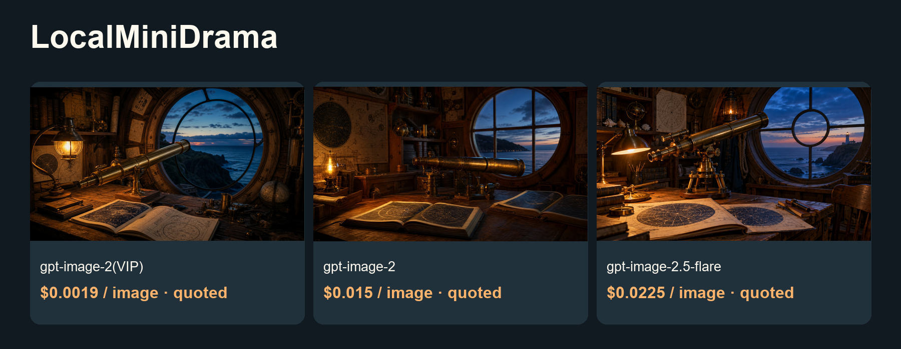
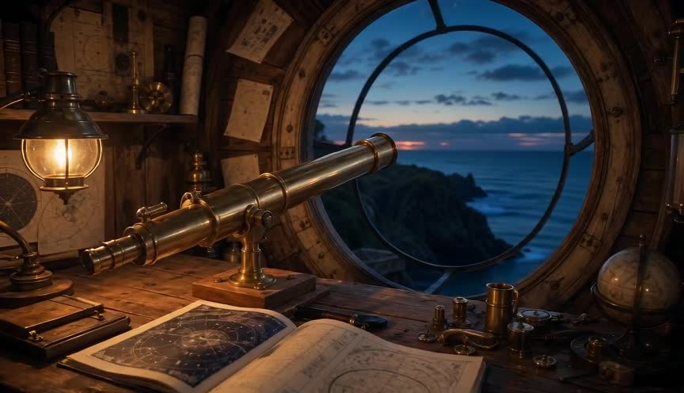

# Lower-cost LocalMiniDrama image and video guide

Local short-drama planning, character/scene assets and video shots.

[中文](README_zh-CN.md) · [Model & pricing](https://go2v.toapis.com/1020_lmd_g) · [Upstream](https://github.com/xuanyustudio/LocalMiniDrama)

**Independent ToAPIs community guide, not an upstream-endorsed edition.** This validates API cases and configuration/module boundaries; full upstream product acceptance is pending.

## Demo



[](examples/seedance-2-mini.mp4)

[▶ Open the original video](examples/seedance-2-mini.mp4)

Video parameters: seedance-2-mini · 480p · 4s requested / 4.04s decoded · 16:9 · generate_audio=false · first-frame I2V.

Confirmed video cost: $0.13338 / clip · $0.03301485148514851485148514851/s (this case).

## Case amounts and model rates (ascending)

2026-10-20.

| Model / preset | Type | Case amount / quote | Applicable model rate | Fee evidence |
|---|---|---:|---|---|
| gpt-image-2(VIP)<br>low / 1K | image | Quoted $0.0019 | $0.0019/image | Configured rate; task billing unavailable |
| gpt-image-2<br>1K | image | Quoted $0.015 | $0.015/image | Configured rate; task billing unavailable |
| gpt-image-2.5-flare<br>high / 1K | image | Quoted $0.0225 | $0.0225/image | Configured rate; task billing unavailable |
| seedance-2-mini<br>480p / 4.04s / no audio | video | $0.13338 | $3.285714/1M total tokens | API billing=settled |

gpt-image-2(VIP) starts at $0.0019/image; this low/1K case is $0.0019/image. Images retain quote labels when task billing is unavailable. Three image models use the same project prompt with different quality presets. Video USD/s is a measured case ratio, not a fixed tariff.

## Project-specific reuse

1. Start the authenticated loopback bridge described below on the same host as the self-hosted backend. Do not expose it publicly or disable outbound safety rules.
2. In AI Configuration choose the OpenAI image protocol and copy integration/localmini-image-config.json fields manually. The UI key is the separate BRIDGE_TOKEN; the real ToAPIs key stays in the bridge.
3. Leave image quality unset for this fixed-preset recipe. The selected API model determines low/standard/high behavior; unsupported fields and reference editing are rejected.
4. The pinned upstream imageClient.callImageApi was exercised with fixture configuration persistence over real loopback HTTP and this batch's saved real PNGs; no new paid call or complete app run was made by that replay check.
5. Native videoClient size/seconds/first-frame mapping remains pending. The supplied Seedance video is an independently validated API asset.

## Run the independent API cases

```powershell
$env:TOAPIS_API_KEY="your_private_key"
python run_case.py --job jobs/gpt-image-2-vip.json
python run_case.py --job jobs/gpt-image-2-vip.json --live
python run_case.py --job jobs/video.json
python run_case.py --job jobs/video.json --live
```

Without --live, only the current key rate is queried. Set a budget locally; the recipe enforces per-request caps, not a hosted-account global spend limit. After errors/timeouts, reconcile the saved task before another submission.

## Optional synchronous compatibility bridge

```powershell
$env:BRIDGE_TOKEN="replace_with_a_separate_random_token_at_least_24_chars"
$env:BRIDGE_PORT="8769"
python bridge.py
```

Binds to 127.0.0.1 only. UI credentials use the separate bridge token. Keep the real generation key in the bridge environment. Preserve upstream outbound/SSRF rules; this is not a public hosted-service endpoint. Image edits are not enabled.

## Original inputs and outputs

```text
An original cinematic storyboard still: a brass telescope rests on a wooden workbench in a tiny coastal observatory, open star charts without readable words, glowing amber desk lamp, deep blue dusk through the round window, handcrafted adventure-film set, detailed wood and brass, clear single composition, 16:9 landscape, no text, no logos, no watermark.
```

[Jobs](jobs/) · [Original media](examples/) · [Sanitized evidence](evidence/) · [Acceptance](ACCEPTANCE.md) · [Upstream and protocol evidence](UPSTREAM.md)

## License and scope

Original guide/adapter code: MIT. Upstream source and trademarks keep their own license and ownership. The OpenShorts fork retains its upstream MIT license. No existing sponsor/referral links were replaced. No audio integration claim is made.
